# USRadioguy GOESTOOLS Ground Station

A complete GOES weather-satellite ground station for the **Raspberry Pi**:
receive the HRIT downlink (1694.1 MHz) from **GOES-19** (East) or
**GOES-18** (West, which also relays **Himawari-9**), decode it with
goestools, and browse the imagery from any phone, tablet or computer on
your network.

This is the setup that runs the [USRadioguy](https://usradioguy.com)
station in Horicon, Wisconsin, packaged so anyone can install it with
**one script**.
## 📖 How to install: start here
**New to this? Follow the step-by-step guide on USRadioguy.com:
[Installing USRadioguy goestools on a Raspberry Pi](https://usradioguy.com/installing-usradioguy-goestools-on-a-raspberry-pi/).**
It walks you through everything, from flashing the SD card to seeing your
first image.

Quick version:
1. Flash a minimum of **32 GB+** microSD card with
   [Raspberry Pi Imager](https://www.raspberrypi.com/software/). Choose
   **Raspberry Pi OS (other) → Raspberry Pi OS Lite (64-bit)**.
2. In Imager's settings, set a hostname, username and password, and Wi-Fi
   if needed, and **enable SSH**. The Pi runs headless: no monitor or
   keyboard.
3. Boot the Pi, log in with PuTTY/SSH, and run
   `sudo apt update && sudo apt full-upgrade -y && sudo reboot`.
4. Run the [Install](#install) commands below, answer the questions,
   then `sudo reboot`.
5. Open `http://<your-pi-ip>/` or `/lab/` in any browser on your network.

> NOTE: AI (Claude) was used to help streamline and check code.

## ☕ Help keep USRadioguy on the air
Everything here is **free**: the software, the install script, the color
tables, the Himawari additions and the guides. Keeping it running isn't
free, though. It takes web servers and hosting, domain fees, the
ground-station hardware, and many hours testing every new Raspberry Pi OS
release and goestools update, so your install just works.

**If this project has helped you get on the air, I could really use your
help.** Even the price of a cup of coffee makes a real difference and
keeps the updates coming.

### [☕ Support USRadioguy on Ko-fi](https://ko-fi.com/usradioguy)

*Thank you. Every bit of support goes straight back into the station and
the software. — Carl*

## What you get
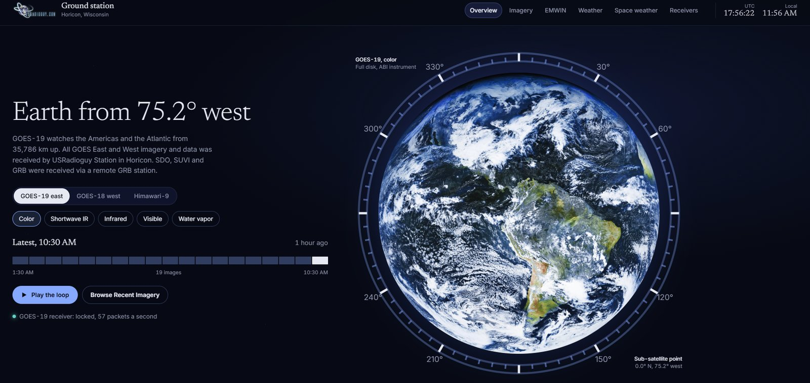
*The Lab view (`/lab/`). More in [Screenshots](#screenshots).*

- **goestools, USRadioguy edition**
  ([creinemann/goestools](https://github.com/creinemann/goestools)),
  built from source. It adds:
  - **USRG_GeoColor**: natural Earth colors for GOES-19, GOES-18 and
    Himawari-9 full disks. A filter using assigned color gradients comes from NASA's Blue Marble for the
    time of year (monthly), HRIT clouds and brightness are live, and colors change with
    the seasons automatically. GOESTools combines Bands 02,07,13's specific grayscale channels to paint the image.
  - **USRG_GeoFusion**: GeoColor with the enhanced Channel 13 cold
    cloud tops laid on top at 75%, for GOES-19, GOES-18 and Himawari-9
  - the USRadioguy night color LUT
  - Himawari-9 color, enhanced infrared and enhanced water vapor
- **Vitality GOES** website: full disk and mesoscale imagery, NWS and
  EMWIN products, local weather, space weather.
- **Lab view** (`/lab/`): a modern front end with satellite tabs, a
  timeline, loop playback and receiver status.
- **Ground Station HUD:** live goesrecv signal quality (Viterbi errors,
  packets per second, gain, frequency) plus the Pi's CPU, temperature,
  memory and disk.
- **24-hour video loops** of every product, rebuilt automatically.
- **Nightly cleanup**, so the SD card never fills up.
- **Themes:** Ground Station, Apollo Panel, Starship Ops, NWS Amber and
  more.

## Screenshots
All taken at the USRadioguy station in Horicon, Wisconsin.

### Lab view (`/lab/`)
| | |
|---|---|
|  | 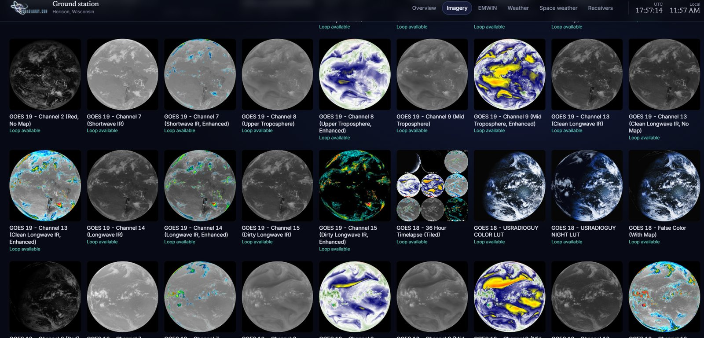 |
| **Overview:** the latest image from each satellite, a timeline and loop playback | **Imagery:** every product your station receives, each with a 24-hour loop |
| 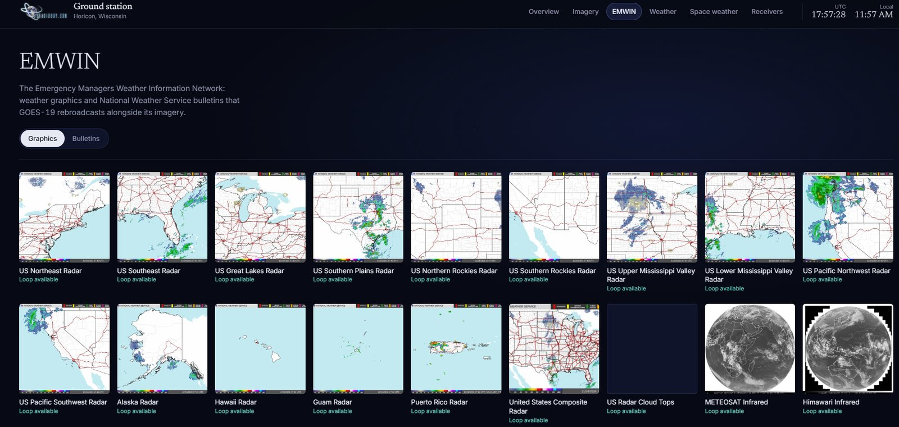 | 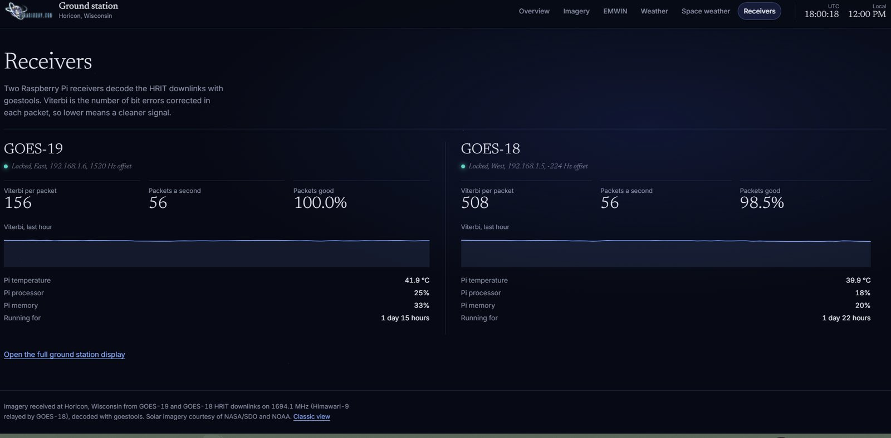 |
| **EMWIN:** NWS radar mosaics, charts and bulletins straight from the satellite | **Receivers:** live signal quality and Pi health for each receiver |

### USRG_GeoColor
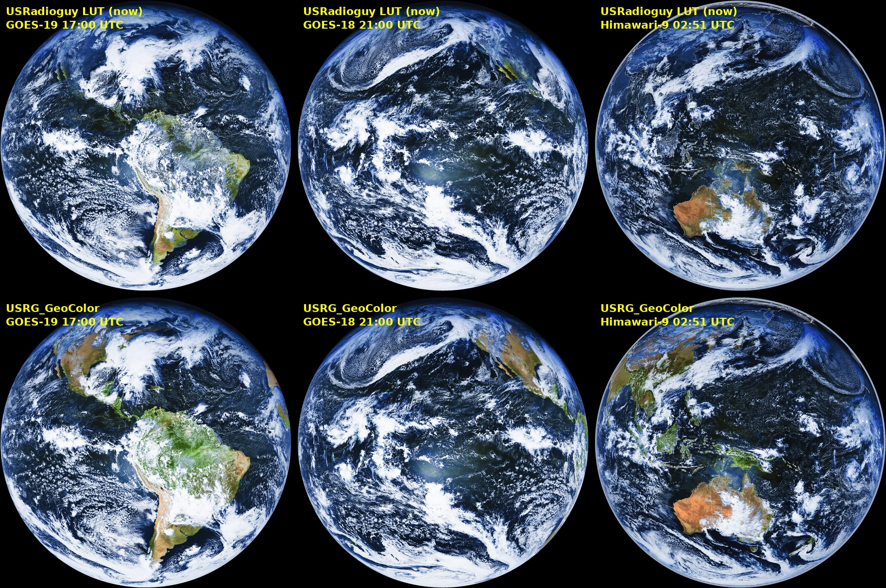
*Top: the USRadioguy color LUT. Bottom: USRG_GeoColor, with natural
land colors for late November. The clouds are the same live data.*

### USRG_GeoFusion
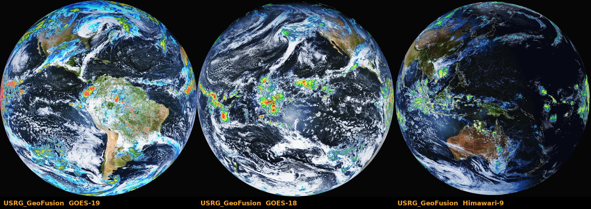
*GeoColor with the enhanced Channel 13 colors on top: grey parts of the enhancement are left out, so only the cold cloud tops are colored.*

### Ground Station HUD
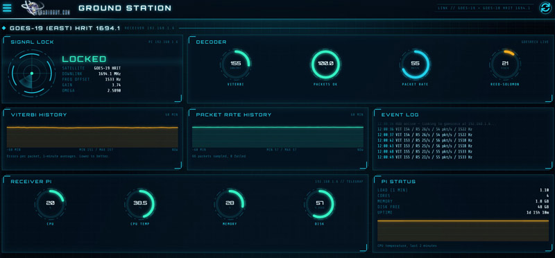
*Live signal lock, decoder stats, Viterbi and packet-rate history, an
event log, and the receiver Pi's CPU, temperature, memory and disk.*

### Themes
Choose a theme under **Settings → Web App Theme** in the classic view.

| | |
|---|---|
| 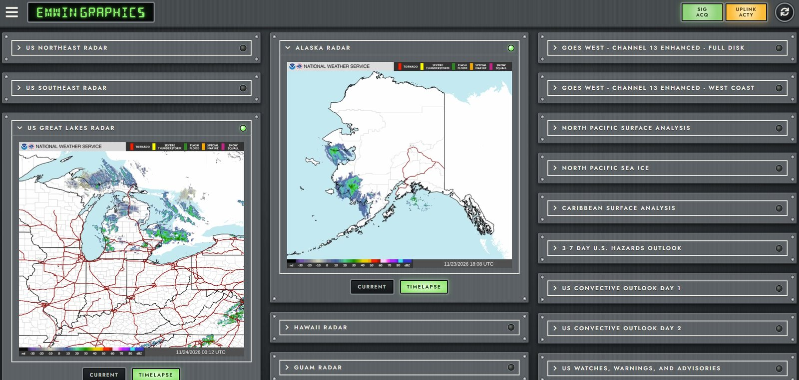 | 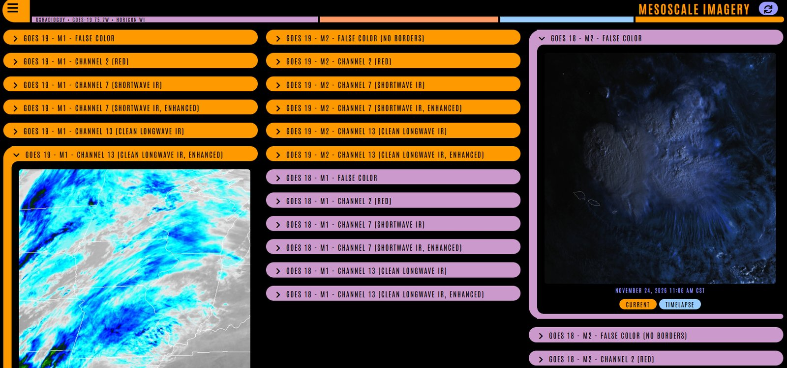 |
| **Apollo Panel (1969):** gray panel plates, green readouts and lit annunciator buttons | **Starship Ops Console:** elbow frames and pill buttons, inspired by sci-fi starship consoles |
| 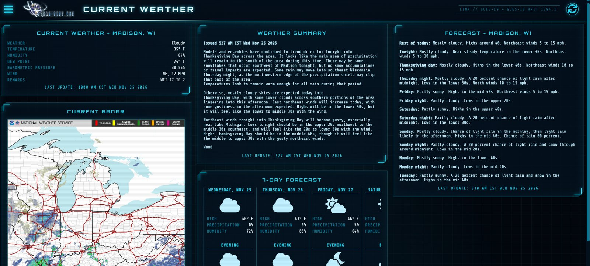 | 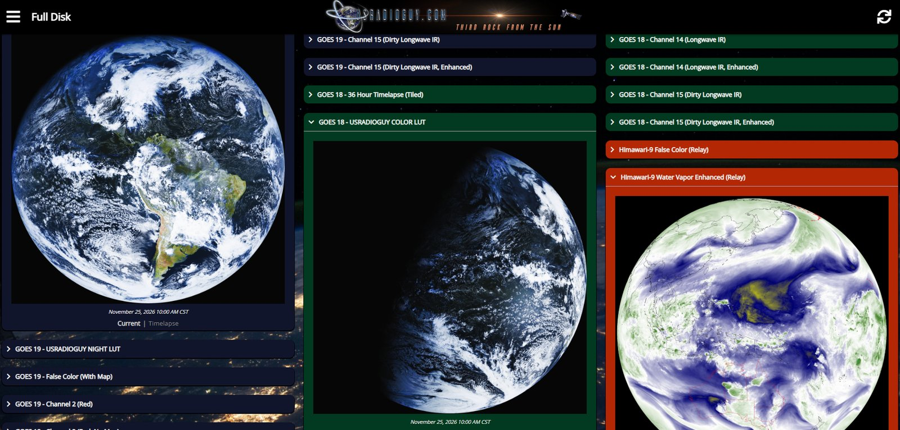 |
| **Ground Station HUD:** cyan holographic mission display, shown on the Current Weather page | **USRadioguy:** the station's house style, shown with full disk, the USRadioguy LUT and Himawari-9 water vapor |
| 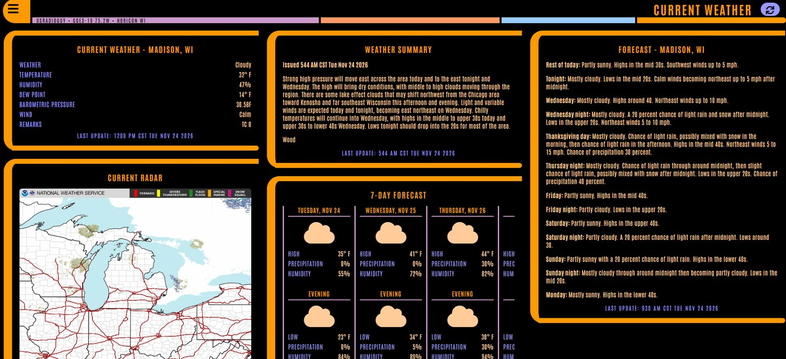 | |
| **Current Weather:** local conditions, radar and forecast from the NWS data your dish receives (Starship Ops) | |

## What you need
| | |
|---|---|
| Computer | **Raspberry Pi 4 or 5** (2 GB+), current Raspberry Pi OS (64-bit). A Pi 3 runs the website, but video loops are turned off by default. |
| Storage | 32 GB+ microSD card (64 GB recommended); a USB SSD is better (about 3 GB/day of imagery, 3 days kept by default) |
| Radio | RTL-SDR (v3/v4) or Airspy, plus a GOES LNA/filter (e.g. Nooelec SAWbird+ GOES) |
| Antenna | A 1.7 GHz grid or dish antenna aimed at your satellite |

## Install
On the Pi (logged in as your normal user, **not** root):

```bash
sudo apt install -y git
sudo git clone https://github.com/creinemann/USRadioguy_GOESTOOLS_Groundstation /opt/groundstation
sudo chown -R $USER: /opt/groundstation
cd /opt/groundstation
./install.sh
```

The installer asks a few questions: which satellite, SDR type and gain,
your station name and location, and the NWS codes for your local
forecast. Then it:
1. installs Apache, PHP, ffmpeg and the build tools;
2. builds and installs goestools to `/usr/local`, about 15–30 minutes;
3. writes `/etc/goestools/goesrecv.conf` and `goesproc-goesr.conf`;
4. generates the website config **for exactly the products your
   goesproc makes**;
5. sets up services: goesrecv, goesproc, video loops every 30 minutes,
   and a nightly cleanup.

When it finishes, run `sudo reboot` once. Then open **`http://<your-pi-address>/`** (or `/lab/`) in
any browser on your network.

> **Already running goestools from `/etc/rc.local` or in `screen`?**
> Remove those lines first. Two copies of goesrecv fight over the SDR,
> and the second one fails with `signal=ABRT`.

### Unattended install
Every question can be answered with an environment variable:
```bash
NONINTERACTIVE=1 SAT=goes18 SDR=rtlsdr GAIN=6 STATION="My Station" \
LOCATION="Anytown, USA" LAT=39.0 LON=-77.0 NWS_STATE=MD NWS_ZONE=MDZ013 \
NWS_ORIG=LWXMD RADAR=NTHES ./install.sh
```
Other options:
- `SHARE=yes` shares the imagery folder on your network, for a Windows
  website. Set the share password afterwards with
  `sudo smbpasswd -a $USER`.
- `SKIP_GOESTOOLS=1` keeps an existing goestools.
- `OVERWRITE_CONF=yes` replaces existing `/etc/goestools` configs.

## After installing
| Task | How |
|---|---|
| Watch the receiver | `journalctl -u goesrecv -f`, or the **Ground Station** page |
| Tune gain / SDR | edit `/etc/goestools/goesrecv.conf`, then `sudo systemctl restart goesrecv` |
| Change station name, receivers, Grafana | edit `web/config/station.ini` |
| Change products | edit `/etc/goestools/goesproc-goesr.conf`, then re-run `./install.sh` (it rebuilds the site config) |
| Turn video loops on or off | `sudo systemctl enable --now groundstation-videos.timer` (or `disable --now`) |
| Days of imagery kept | `KEEP_DAYS` in `/etc/default/groundstation` |
| Update | `cd /opt/groundstation && git pull && ./install.sh` (see [Updating](#updating)) |

### Updating
Updates bring new features, fixes and the newest USRadioguy goestools.

**On the Pi** (log in with PuTTY), paste:
```sh
cd /opt/groundstation && git pull && ./install.sh
```
- Press **Enter** at each question. The defaults are your answers from
  last time.
- It rebuilds goestools (15–30 minutes), updates the website, and
  restarts everything. Imagery keeps coming in until the restart.
- **Your settings are kept:** station name, `station.ini`, and your
  goestools configs. When a config changes in an update, the new
  version is saved beside yours as `.new`.
- **Only the website changed?** Skip the rebuild:
  `cd /opt/groundstation && git pull && SKIP_GOESTOOLS=1 ./install.sh`
- **"Permission denied" from `git pull`?** Run
  `sudo chown -R $USER: /opt/groundstation` once, then try again. Use
  plain `git pull`, never `sudo git pull`.

**Turning on USRG_GeoColor on an earlier install:** the update keeps
your own `/etc/goestools/goesproc-goesr.conf` and saves the new one
beside it as `goesproc-goesr.conf.new`. If you never edited yours, switch
to the new one and refresh the website settings:
```sh
sudo cp /etc/goestools/goesproc-goesr.conf.new /etc/goestools/goesproc-goesr.conf
cd /opt/groundstation && SKIP_GOESTOOLS=1 ./install.sh
```
If you did edit it, copy the `[handler.geocolor]` lines from the `.new`
file into your own config instead.

**On a Windows website PC: -not a standard install!!** download the new ZIP (**Code → Download
ZIP**), extract it over `C:\USRadioguy-Groundstation`, and run
`install-windows.ps1` again as administrator. It remembers your answers.

**Running goestools without this package?** See
[Updating in the goestools guide](https://github.com/creinemann/goestools/blob/main/USRADIOGUY.md#updating).

### Space weather from the internet (optional)
No GRB station? The installer asks *"Turn on space weather from the
internet?"*. Answer **yes** to get the Sun from NASA SDO and GOES-18
SUVI (UW-SSEC), plus NOAA SWPC aurora, solar wind (WSA-ENLIL) and
geospace forecasts. **This needs the Pi to be able to reach the
internet.**

Nothing downloads by itself. The Earth Lab's **Space** page gets a
**Download the latest images** button; pressing it fetches the newest
copy of each image (skipping any saved in the last 10 minutes) into
`spaceweather` in your imagery folder. Images build up a history each
time someone presses it, and files older than 3 days are removed. If
you also have a GRB folder, its images are used and the internet fills
in the rest.

### Space Weather pages (optional, for GRB stations)
GOES HRIT doesn't carry Sun imagery, but a **GRB** station does. If
you have a folder of SDO/SUVI images (yours, or one shared from a GRB
receiver), give its path when the installer asks *"Folder of SDO/SUVI
space weather images"*. That turns on the **Space Weather** page in the
classic site, the **Space** page and Sun picture in the Earth Lab, and
24-hour loops of SDO 193 and 171. Press Enter to skip it.

The pages find images by these parts of the file names (the names used
at the USRadioguy station): `SDO_193_`, `SDO_171_`, `SUVI195_`,
`SUVI284_`, `SUVI303_`, `SUVI093_`, `AURORA_`, `WSA_ENLIL_`,
`geospace_3_day_`. Only the products found in the folder are listed.
Different names? Edit `web/config/solar.ini` after installing.

Space weather **alerts** and EMWIN **space weather messages** come over
HRIT, so they work on every station, with or without this folder.

### Viewing from outside your home
By default the site is visible **only on your own network**. Don't
port-forward it to the internet. For remote access, install
[Tailscale](https://tailscale.com) on the Pi and on your phone or laptop.

## Repository layout
```
install.sh                  Raspberry Pi installer
install-windows.ps1         Windows (XAMPP) website installer
goestools/                  goesrecv.conf and goesproc configs (GOES-19, GOES-18 + Himawari-9)
web/                        the website (Vitality GOES + USRadioguy additions)
  config/station.ini.example  station name, receivers, optional Grafana keys
  lab/                        Lab view
  station_stats.php           receiver + system stats for the HUD and Lab view
scripts/
  make-site-config.py       writes the site config from your goesproc config
  create-24h-videos.py      24-hour video loops (Linux)
  cleanup-imagery.sh        deletes old imagery
systemd/                    service and timer units (filled in by install.sh)
templates/vitality/         product catalog the site config is built from
windows/                    Windows scripts: video loops, cleanup, copy imagery from the Pis
```

### Running the website on Windows
> **⚠️ Only recommended if your imagery resides on the PC.** The Windows
> website reads every image from a folder on the PC. It can't show images
> that live only on the Pi. If your imagery stays on the Pi, use the
> website the Pi already runs (`http://<pi-address>/`). The installer
> below can copy imagery from your Pis to the PC every 5 minutes. That
> uses about 10 GB of PC disk per satellite for 3 days.

Your receivers stay on Raspberry Pis, and the website runs on a Windows
PC with [XAMPP](https://www.apachefriends.org). There's a one-script
installer for this too:

1. On each receiver Pi, answer **yes** to *"Share the imagery folder on
   your network"* when you run `./install.sh`. That shares the imagery
   read-only as `\\<pi-address>\goes`.
2. On the PC, install XAMPP. Then download this repository
   (**Code → Download ZIP**) and extract it to a permanent folder, e.g.
   `C:\USRadioguy-Groundstation`.
3. Open **PowerShell as administrator** and run:
   ```powershell
   cd C:\USRadioguy-Groundstation
   powershell -ExecutionPolicy Bypass -File .\install-windows.ps1
   ```

The installer:
- checks for Python and ffmpeg, and offers to install them with winget;
- copies the website into XAMPP (backing up anything it replaces);
- asks the same questions as the Pi installer, plus your Pis' addresses;
- builds the website settings;
- turns on Apache as a Windows service;
- allows the site through the firewall (home networks only);
- creates scheduled tasks under **Task Scheduler → USRadioguy Ground
  Station**:
  - copy imagery from the Pis every 5 minutes;
  - 24-hour video loops every 30 minutes;
  - nightly cleanup.

The share password is stored encrypted, and only administrators can read
it. Live signal stats come straight from each Pi. Pi health (CPU,
temperature) on a Windows site needs optional Grafana keys in
`web\config\station.ini`.

Already copying imagery your own way? Answer **no** to the copy
question and point the installer at your imagery folder.

### Several receivers (like the USRadioguy station)
Run one receiver Pi per satellite and the website on one of them, or on
a separate computer:
- Add each Pi as a `[receiver.<id>]` section in `station.ini`, with its
  address.
- Optionally add a read-only Grafana key for each, to show that Pi's
  health and history.
- Generate the site config with one `--sat`/`--goesproc` pair per
  receiver.

## Credits and license
- **Vitality GOES:** © 2022-2025 Jamie Vital,
  [JVital2013/vitality-goes](https://github.com/JVital2013/vitality-goes)
- **goestools:** © Pieter Noordhuis and contributors,
  [pietern/goestools](https://github.com/pietern/goestools)
- **USRadioguy additions** (Lab view, HUD, themes, LUTs, Himawari
  support, Pi installer, Linux scripts): © 2023-2026 Carl Reinemann,
  [usradioguy.com](https://usradioguy.com)
- Fonts in `web/lab/fonts` and the themes are under the SIL Open Font
  License; see the `OFL-*.txt` files.
- SDO imagery courtesy of NASA/SDO. SUVI and space weather products
  courtesy of NOAA.

If you find this useful, please [support it on Ko-fi](https://ko-fi.com/usradioguy).

Licensed under the **GNU General Public License v3**; see [LICENSE](LICENSE).
